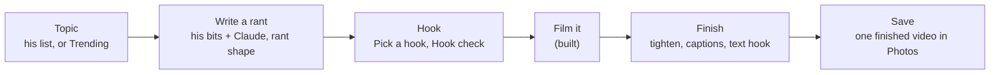

# SPEC 2026-11-06: the Rant tab (topics and trends, write it, film it, finish it)

Status: **slice 1 built 2026-11-07** (branch `app/rant-tab`, TestFlight build 25; §11 lists what is in and the
calls taken against this text). Slices 2-4 proposed, not built. Owner direction 2026-11-06 (and 2026-11-07: "i dont see the
new record/rant tab/button, where are we with that ?? lets get it going"):

- "the recording works, but i dont like that its hidden, i think it should be one of the main features"; "lets name it
  rant".
- "we want to write the rant first, get ideas from bits/jokes etc and have tools/ai to help create it in a ranting
  style, and suggest hooks / edits dead space afterwards for post processing".
- "put the share part on the roadmap, and continue with the post processing/editing/captions/hook info/trend info...
  I should be able to see whats trending, or maybe i have topics i want to rant on"; "we dont need a full post
  processing utility but the point is to make a rant, captions/post processsing etc save and so its ready to post".

**The goal: one finished video in Photos, ready to post.** Posting itself is on the roadmap (§9).

Built on: `SPEC-2026-11-03-film-it.md` (Film it v1 and the rant half: Make it a rant, Pick a hook, the cuts) and
`SPIKE-2026-11-03-film-it-feasibility.md` (word timings §4.1, the native video paths §4.2).

## 0. The path

## 1. Decisions (lead calls, owner may flip)

| # | Decision | Why |
|---|---|---|
| R1 | The first tab is **Rant** (SF Symbol `megaphone.fill`); **Tonight goes**. | Owner. He picks tonight's set in Sets. |
| R2 | Tonight's parts move: the set list bar and **Record a set** to the top of **Sets**; "N to sort" (with the badge) and **Record a memo** to **Bits**; "Ask your material" stays as the Bits search. Settings stays behind the avatar on every tab. The routes in the `(tonight)` group keep their URLs (a group name never appears in a URL). | Nothing is lost; each lives where he goes for it. |
| R3 | **A rant is a bit** whose newest cut is `rant` (Film it D10), linked to the bits it drew on. No new table for rants. | Versions, the stepper, Pick a hook, Film it and the learning loop all work on it unchanged. |
| R4 | The tab bar stays navigation only; the record control is the tab's content, not a tab button. | HIG/tab-bars: a tab bar navigates, it does not act. |
| R5 | Finishing happens **before the take is saved**, in the review. | The take's file is deleted after Keep and Photos access is add-only (`lib/film.native.ts:9-17`): nothing can be edited after. |
| R6 | The finishing engine is **Apple's AVFoundation in one local Expo module**, no FFmpeg, no third-party framework (§6.3). | ffmpeg-kit is retired; the maintained Swift frameworks are stale; everything needed ships with iOS. |
| R7 | New server work (`rant_draft`, `trends`, `text_hook` jobs and their routes) is written **once, in Rust**, after the Rust images build; not twice as the rant half was. | The cutover is the standing direction. Owner may flip to "Python now" to ship sooner. |

## 2. The Rant tab

A large title "Rant". Toolbar: **+** New rant (primary, trailing), the avatar. Top to bottom:

- **Film a rant** (a 60-pt red disc row): opens Film it on the newest rant marked ready, or a picker when there are
  several. Never films without a script (owner: the rant is written first).
- **My topics**: his own list, typed ("+ Add a topic"). Row: the topic · how many of his bits match it (today's
  search). Tap = Write a rant on it. Swipe: Delete. A topic used for a rant shows "ranted Nov 6".
- **Trending** (§4): five to ten cards, newest first. Tap = the card; "Rant on this" starts Write a rant; "Save to my
  topics" moves it into My topics.
- **Drafts**: rants not filmed yet. Row: short name · "v3 · Nov 6" · "hook" when one is picked.
- **Finished**: the videos he saved, newest first: "Nov 6 · 0:58 · captions · in Photos". Tap = play it (the system
  player), and the bit it came from.

Empty state: "Add a topic or pick one from Trending." Offline: the AI rows and Trending grey with "offline"; filming,
reading and finishing still work (finishing is on the phone).

## 3. Write a rant (`/rant/new`, a full-height sheet)

1. **Topic**: one text field, "What's the rant about?", typed (jots are typed); filled when opened from a topic, a
   trend card, or a bit's ⋯ › "Rant on this".
2. **Gather**: today's search (`/api/search`: bits, typed ideas, taped moments) on the topic, the hits with
   checkboxes. "Find more" widens it (`/similar` from each ticked bit). A trend card's links ride along as context
   (never as his lines).
3. **Draft**: "Write it" asks the worker (`rant_draft`, Opus). Lines in rant shape: **the hook, the setup in one
   breath, beats that escalate, the turn, the button.** Each line is either:
   - **his**: quoted word for word from a ticked source and verbatim-checked against it (the standing rule), shown
     plain with its source under it ("from Self-checkout v8");
   - **new**: a connecting or escalating line Claude wrote, with the AI badge.
   He Keeps or Skips each new line (the hunk rows of Make it a rant); his lines stay unless he cuts them.
4. **Save rant**: a new bit, its first version in cut `rant` (`source: rant_draft`), linked to the ticked bits (`from`
   links, shown under Elsewhere), the topic marked "ranted". Skipped lines teach the profile as passed-over lines,
   kept ones as kept lines (the learning loop).

Cost (INFERRED from Film it §8): a draft about $0.06-0.10 on Opus, inside the $2 daily cap.

## 4. Trending (the `trends` job, server side)

Research 2026-11-06 (official pages; CONFIRMED unless marked):

| Source | What it gives | Terms that matter | Use |
|---|---|---|---|
| Bluesky `app.bsky.unspecced.getTrendingTopics` | Live topics with a description and a feed link, no login | "unspecced" = may change without notice (INFERRED) | **yes**, every 30-60 min |
| Google Trends "Trending now" RSS (US) | 10 searches with approximate traffic ("1000+") and 1-3 news links each | no licence text in the feed; Google's terms apply (INFERRED): cache, link out, poll gently | **yes**, hourly |
| Wikipedia pageviews (top articles per day) | What people read yesterday | CC0; a User-Agent with contact details | **yes**, daily |
| Claude web search (`web_search_20260318`) | Ranks and explains the above against his angles, with citations | $10 per 1,000 searches; "citations must be included to the original source" | **yes**, twice a day, ~10 searches a run (~$3-6 a month) |
| GDELT DOC 2.0 | Headlines, last 3 months | free, cite GDELT | later |
| YouTube `videos.list chart=mostPopular` | **The actual most-viewed videos** by region (and category; Comedy's chart may be missing, INFERRED) | 1 quota unit a call; store ≤ 30 days, show YouTube as the source | **yes** (a "Viral on YouTube" row), daily |
| X trends | **The real trending list** | $0.010 a request, post reads $0.005 each (pricing page 2026-11-06); no free tier | **yes, if the owner agrees** to about $1-2 a month (4 calls a day) |
| Instagram Hashtag Search (`ig_hashtag_search`, `top_media`) | The most popular public posts **for a hashtag he names** (caption, comments, likes, permalink); no "what is trending" list | Facebook Login only, a Business/Creator account linked to a Page, the "Instagram Public Content Access" feature; **30 unique hashtags per 7 days**; whether it works in Development mode without App Review is **UNKNOWN** (Meta's App Review page and third-party guides disagree) | **try**, once he links a Page: a few fixed hashtags (#rant, #standup) |
| Threads keyword search (`search_type=TOP`, `media_type=VIDEO`) | Popular posts for a keyword | "without approval, the search will be performed only on posts owned by the authenticated user": needs App Review | no |
| TikTok Creative Center / Research API | Hashtags, sounds / video data | **no public API; the terms forbid automated extraction**; the Research API is for academic and not-for-profit researchers only | **no** (an "Open TikTok trends" link opens the website for him to browse) |
| Reddit | Hot posts | approval needed, free tier uncertain (INFERRED) | no |
| NewsAPI free / Google News RSS | News | not for production / personal non-commercial only | no |

The job: fetch the three feeds, then one Sonnet call with web search, his **angles** (the "What I rant about" list in
Settings › Voice profile, typed; empty means "everyday life") and his topic list, asked to keep 5-10 topics that fit an
angle. Each card shows:

- **the topic** (a short title);
- **why it's hot** (one line with the signal: "200K+ searches", "trending on Bluesky", "#3 on Wikipedia yesterday");
- **the links** (one or two, always: the citation);
- **an angle** (Claude's one-line rant angle, AI badge, tied to one of his angles and, when one exists, a bit of his
  that already touches it).

Raw feed rows are kept 7 days, cards 30. The job never runs when the daily budget is spent; the cards then say "from
this morning".

## 5. Hook info

- **Pick a hook** (built): three openers, pick one or none.
- **Hook check** on the script (no AI, `rules/hookRules.ts`): the seconds to the hook's last word at his pace
  (`rules/prompterRules paceWpm`), flagged when over 3 s ("hook lands at 4.2 s"); the words before the first line that
  is his; whether line 1 is a question, a claim or a scene (a word, not a score).
- **Hook check** on the take (in Finish): when the hook's words were actually said (the word timings), "hook at 0:01.8".
- **Text hook**: the on-screen words over the first seconds (the common format for rants). Default: the hook line cut
  to its first 6 words; "Suggest" asks the worker (`text_hook`, Haiku) for three 3-7-word versions, AI badge; any that
  quote him are verbatim-checked.

## 6. Finish (the review, before saving)

### 6.1 What he sees

After the take, the review (Film it §2.4) becomes **Finish**: the take plays, and under it, each a row with a switch:

| Row | Default | What it does |
|---|---|---|
| **Tighten** "cuts 0:07" | on | gaps between words over 0.6 s become 0.25 s; before the hook's first word and after the last word + 0.5 s are cut |
| **Captions** | on | burned in, word by word: pages of 1-4 words, the current word highlighted, inside the safe area (above the platforms' bottom UI) |
| **Text hook** "Nobody asked for this" | on | the text hook (§5) over the first 3 s, then it fades; tap to edit |
| **Hook check** | (a line) | "hook at 0:01.8" or "hook lands late: 0:04.6" |

**Preview** renders it and plays the result. **Save** renders (if not already), saves **one** finished video to
Photos, records it under Finished, and discards the raw take ("Keep the original too" in the ⋯ for the rare case).
Redo and Discard as today.

Requires: the take transcribed **before** Save (today it is transcribed after Keep from the queue): the review starts
on-device transcription as it opens (`lib/transcribe.native transcribeFile`, Apple's on-device recognizer, the audio
stays on the phone) and keeps the per-word timings (`words: [{w, s, e}]`, SPIKE §4.1; `rules/memoRules addFinal`
folds them today, so a new rule keeps them). The words still go to the server as an idea on the bit (today's route).

### 6.2 The rules (TypeScript, tested without a Mac)

| File | Rule | Test |
|---|---|---|
| `rules/tightenRules.ts` | word timings → keep-ranges; the summary "cuts 0:07" | each arm red against a planted lenient rule (`--red`) |
| `rules/captionRules.ts` | words → pages (1-4 words, a page never crosses a sentence end or 1.6 s), shifted onto the cut timeline | same |
| `rules/hookRules.ts` | the hook check on the script and on the take | same |

### 6.3 The engine (`app/modules/punchable-video`, Swift, AVFoundation only)

Research 2026-11-06:

| Option | State | Verdict |
|---|---|---|
| ffmpeg-kit | **retired**, archived 2026-07-02 (CONFIRMED); its successor publishes no packages (build it yourself), LGPL/GPL | no |
| react-native-video-trim | trims only, pulls in FFmpeg (CONFIRMED) | no |
| VideoLab, Cabbage, MetalPetal, GPUImage3 | MIT/BSD, no push since 2024 (CONFIRMED); VideoLab's text is Core Animation anyway | no |
| Skia video export (`@azzapp/react-native-skia-video`) | "still a beta in a very unstable state" (CONFIRMED) | no |
| Remotion, Revideo, Motion Canvas | render in a browser or on a server, not on iOS (CONFIRMED for Remotion) | no |
| IMG.LY, Banuba, Shotstack, Creatomate | commercial, priced for companies | no |
| **AVFoundation** | `AVMutableComposition` (cuts), `AVVideoCompositionCoreAnimationTool` (burned layers, "interpreted on the video's timeline"), async `AVAssetExportSession.export(to:as:)` (CONFIRMED) | **yes** |

One call: `render(input, keepRanges, captionPages, hook, style, output) -> {uri, durationMs}` with progress events:

1. **Cuts**: an `AVMutableComposition` that copies each keep-range of the video and audio tracks back to back, the
   source's `preferredTransform` carried (the file is unmirrored; check the front camera's orientation).
2. **Captions**: a parent layer (geometry flipped), the video layer, one `CATextLayer` per page with opacity keyed to
   the shifted word times (`AVCoreAnimationBeginTimeAtZero`, `isRemovedOnCompletion = false`), the current word's
   highlight as its own animated layer.
3. **Text hook**: one text layer, fading out at 3 s.
4. **Export**: HEVC, 1080 × 1920, `export(to:as:)` (the old `export()` is reported crashing on iOS 26.6.1,
   INFERRED), wrapped in a background task with the screen kept awake.

Size INFERRED: 350-550 lines of Swift, about 100 of TypeScript. Loaded lazily like `expo-camera` ("Not in this build
yet." on an older binary). Fonts: the caption font is bundled and loaded as a `CTFont` in Swift (`expo-font` fonts are
not visible to Core Animation, INFERRED).

**The risk: it compiles only on EAS (no Mac).** A Swift mistake costs a build, and layer geometry only shows on the
device. Mitigations: the rules carry all the arithmetic (tested); the module reports every failure to Bugsink with the
step; **Settings › About › Device checks** gains "Render a sample": a fixed 10-second synthetic clip through every
step, so a build is judged in one tap.

Later, in order of cost (INFERRED sizes): a cover frame (~30 lines), music under it with ducking (~60), zoom
punch-ins on emphasis (~80), loudness levelling (~120), **retakes** (a script line said twice keeps the last one: word
alignment to the script, in `tightenRules`).

## 7. Data

| Change | Where |
|---|---|
| `topic {text, created, ranted_at?, from_trend?}` | new table, owner-only |
| `trend {topic, why, links[], angle, sources[], at}`; raw feed rows 7 days, cards 30 | new tables, written by the `trends` job |
| `profile:voice.angles: string[]` | the voice profile (Settings) |
| `take.finished: {duration_ms, tightened_ms, captions, text_hook, at}` | the `take` row (Film it §5) |
| `link {from: rant bit, to: source bit, kind: "from"}` | today's links |

## 8. Slices (each its own TestFlight build)

| Slice | What | New binary? | Server |
|---|---|---|---|
| **1** | The Rant tab (§2) with My topics, Drafts, Finished; Tonight's parts moved (R2); Write a rant (§3); Hook check on the script (§5) | **No** (JS on build 23's binary set) | `topic` routes, `rant_draft` job |
| **2** | Trending (§4), angles in Settings | No | `trends` job and routes |
| **3** | Finish (§6): transcription before Save, Tighten, burned captions, text hook (+ Suggest), Hook check on the take, Save to Photos, Device checks › Render a sample | **Yes** (`punchable-video`) | `text_hook` job |
| **4** | Retakes, cover frame, music, punch-ins, loudness | Yes | none |

## 9. Roadmap: posting (owner 2026-11-06: "put the share part on the roadmap")

Kept here so the research is not redone. Owner rule for when it is built: a finished video goes to the server only
when he taps Post to a platform that needs it there, to a bucket that holds nothing else, deleted once the platform
has it (7-day lifecycle); takes he does not post never leave the phone.

| Platform | Path | Why (research 2026-11-06, official pages) | Needs from the owner |
|---|---|---|---|
| YouTube Shorts | direct (Data API `videos.insert`) | a vertical video ≤ 3 min is a Short; unverified projects' uploads no longer locked private (revision history 2026-11-02); ~100 quota units an upload | `youtube.upload` on the Google project, consent screen In production |
| Instagram Reels | direct (Instagram API with Instagram Login, container + publish) | HEVC .mov accepted, 3 s-15 min; Development mode publishes for accounts with a role, no App Review | a Creator account; a Meta app with him as tester; a public URL while Meta fetches (INFERRED a presigned URL works) |
| Threads | direct (Threads API, video) | HEVC/H.264, ≤ 5 min; testers allowed | the Threads tester invite |
| TikTok | Share Kit (TikTok's editor, he posts there) | the Content Posting API refuses "a utility tool to help upload contents to the account(s) you or your team manages"; unaudited posts are "SELF_ONLY" | a TikTok developer app with Share Kit, reviewed |
| Facebook | share sheet | the Reels API posts to Pages only, 3-90 s | nothing |
| X | share sheet | API is pay per post and wants H.264 720p | nothing |

The share sheet (`Share.share({url, message})`, CONFIRMED to share a file and return the chosen `activityType`,
`RCTActionSheetManager.mm:257-293`) with the caption copied first (`expo-clipboard`; most apps drop text sent with a
video, INFERRED), a posted mark from the activity type, and "Mark as posted". A caption per platform from Claude
(owner: yes), AI badge, verbatim-checked where it quotes him.

## 10. Owner checks (per slice, written when built)

**Slice 1 (build 25), in order, one line each:**

1. The tab bar reads **Rant · Bits · Sets**, Rant first with a megaphone; the app opens on Rant.
2. **Sets** opens on tonight's set list bar (tap: the list) and **Record a set** under it, then Set lists · Recorded.
3. **Bits** shows "N to sort" as its first row (tap: the inbox, Back returns to Bits); the Bits tab carries the badge
   when there is something to sort; **⋯** holds Record a memo, Import a recording… and a Sort section with a check.
4. Bits' search still asks: type a question, tap Ask: the conversation opens **in Bits** (no tab switch).
5. Rant › My topics › type "self-checkout machines" in **Add a topic**, Return: it lists, and a moment later reads
   "3 bits" (the close matches only; it may say another number). Long-press it: Delete; swipe left: Delete, Undo.
6. Tap the topic: **Write a rant** opens full height with the topic filled; "From your material" lists his bits, the
   close ones ticked, taped moments unticked; untick one, tick another; Find more adds more.
7. **Write it**: "Writing…" and the worker line, then the lines (about 6-14): his lines plain with "from <bit> v8"
   under them, new lines with the AI badge; a **Hook check** above them: "Hook lands at 2.1 s" (or "late") and "a
   claim · 4 words before yours".
8. Skip one new line (it strikes through, the button reads Put back), Cut one of his; the hook check updates. **Save
   rant** (top right, grey until there is a line) → "Saved as v1 · rant", the sheet closes, the new bit's page opens
   (in Bits) on v1 · rant; Elsewhere shows the bits it drew on.
9. Back on Rant: the topic reads "ranted Nov 7"; **Drafts** lists the rant ("v1 · Nov 7"); **Film a rant** (the red
   disc) opens Film it on it (with two drafts: a picker).
10. Film a take and Keep it: the rant moves from Drafts to **Finished** ("Nov 7 · 0:58 · in Photos"); tap: the take.
11. Pick a hook on the new bit (its page's sparkle) still works on the rant cut.
12. Airplane mode: Add a topic and Write it grey with "offline"; Film a rant still opens.
13. Swipe down a Write a rant sheet with lines in it: it does not close; Close asks "Leave without saving?".

Tell us: whether the drafted lines sound like him (the his / new split), whether "3 bits" matches what he expects for a
topic, and whether opening the saved rant in Bits (the tab switches) is fine or should stay on Rant.

## 11. Built

| Slice | What is in (2026-11-07, branch `app/rant-tab`) | Calls taken against this text |
|---|---|---|
| 1 | **App:** the tab bar is Rant · Bits · Sets (`lib/TabsShell.native.tsx`, `megaphone.fill`, the "N to sort" badge on Bits); the `(tonight)` group is now `(rant)` and its index is the Rant screen (`app/(tabs)/(rant)/index.tsx`: Film a rant, My topics, Drafts, Finished); the inbox, the conversation (`/say`), Ask and Import moved into Bits' stack; Sets opens on tonight's bar (`lib/SetBar.tsx` TonightCard) and Record a set; Bits has "N to sort" and a ⋯ with Record a memo, Import a recording… and Sort; `lib/tonight.ts` (the Tonight screen's request, which feeds the badge from launch); Write a rant (`app/rant/new.tsx`, a full-height form sheet; `lib/rant.ts`); `rules/rantRules.ts`, `rules/hookRules.ts`; tests `rantRules.test.mjs` and `rantTab.test.mjs` (the Tonight-parts move read from the files), each with a `--red` arm. **No new native module** (JS only on build 23's binary set). **Server (Rust only, R7):** pk-api `GET`/`POST /api/topics`, `PATCH /api/topics/<id>` (`ranted` / `delete`), `POST /api/rant/draft`, `GET /api/rants` (`writes/rant.rs`, the prepared Ingress); pk-worker kind `rant_draft` (`kinds/rant_draft.rs`); the `topics` creative store (`pk-creative` reducers/topics.rs). | (1) **Every drafted line is in until he takes it out** (Cut his, Skip a new one, Put back): the standing owner rule "no review step is ever required" wins over §3.3's "Keeps or Skips each new line"; Save is always shown, inactive until there is a line. (2) **Topics are a creative store** (`creative_event` rows, store `topics`, append-only like the others), **not a new table**: no schema change, nothing for `schema_extra` (so nothing to coordinate with round 5's schema owner). (3) `rant_draft` **reuses the `creative_rant` task** (Opus, high effort): a new task would change the Python-recorded routing goldens for a kind the Python never runs; it shares that task's spend line. (4) The Python API's `JOB_KINDS` tuple gains `rant_draft` (vocabulary only: the Python replays the shared `jobs` store and refuses an unknown kind, which would break every creative route it still answers); the Python worker never runs it. (5) Trending is slice 2: no Trending section, and the empty state reads "Add a topic, or tap + to write a rant." (6) Tonight's three suggested questions and the "Last set" row are not carried over (asking is the Bits search; the last set is Sets › Recorded). (7) The conversation, Ask and Import moved with the inbox to Bits (reviews: a tap there must not switch tabs); the bit page stays in Bits, so a Drafts row and Save open it there (the tab switches). (8) A topic's count is the close search hits only (a word match, or a distance under 0.4) from `/api/search?limit=12`, once per topic per session. (9) Film a rant has no "ready" mark: the one draft, or a picker of the newest five. Finished = Film it takes of rant bits kept on this phone (no captions until slice 3). (10) Hook check shows in Write a rant (the script), not on the bit page. (11) A his line may be part of a source line; it must sit on word boundaries and within one of his lines (the verbatim gate plus those two checks); a line that fails is dropped, never shown as his and never re-labelled new. (12) A topic typed in the sheet that is not in My topics is not added to it. (13) The draft's cache key is the topic and the sources' words (a new version of a ticked bit is a new draft), not their tick order. (14) At most 200 topics (the route's 400, not the reducer's). |
