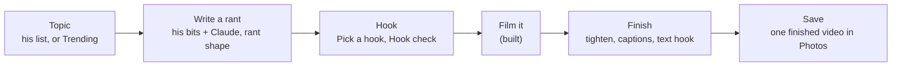

# SPEC 2026-11-06: the Rant tab (topics and trends, write it, film it, finish it)

Status: **slice 1 built 2026-11-07** (branch `app/rant-tab`, TestFlight build 25; §11 lists what is in and the
calls taken against this text). Slices 2-4 proposed, not built. **§12 (owner feedback 2026-11-07) replaces §2 and §3 where they differ: read it first.** Owner direction 2026-11-06 (and 2026-11-07: "i dont see the
new record/rant tab/button, where are we with that ?? lets get it going"):

- "the recording works, but i dont like that its hidden, i think it should be one of the main features"; "lets name it
  rant".
- "we want to write the rant first, get ideas from bits/jokes etc and have tools/ai to help create it in a ranting
  style, and suggest hooks / edits dead space afterwards for post processing".
- "put the share part on the roadmap, and continue with the post processing/editing/captions/hook info/trend info...
  I should be able to see whats trending, or maybe i have topics i want to rant on"; "we dont need a full post
  processing utility but the point is to make a rant, captions/post processsing etc save and so its ready to post".

**The goal: one finished video in Photos, ready to post.** Posting itself is on the roadmap (§9).

Built on: `SPEC-2026-11-03-film-it.md` (Film it v1 and the rant half: Make it a rant, Pick a hook, the cuts) and
`SPIKE-2026-11-03-film-it-feasibility.md` (word timings §4.1, the native video paths §4.2).

## 0. The path

## 1. Decisions (lead calls, owner may flip)

| # | Decision | Why |
|---|---|---|
| R1 | The first tab is **Rant** (SF Symbol `megaphone.fill`); **Tonight goes**. | Owner. He picks tonight's set in Sets. |
| R2 | Tonight's parts move: the set list bar and **Record a set** to the top of **Sets**; "N to sort" (with the badge) and **Record a memo** to **Bits**; "Ask your material" stays as the Bits search. Settings stays behind the avatar on every tab. The routes in the `(tonight)` group keep their URLs (a group name never appears in a URL). | Nothing is lost; each lives where he goes for it. |
| R3 | **A rant is a bit** whose newest cut is `rant` (Film it D10), linked to the bits it drew on. No new table for rants. | Versions, the stepper, Pick a hook, Film it and the learning loop all work on it unchanged. |
| R4 | The tab bar stays navigation only; the record control is the tab's content, not a tab button. | HIG/tab-bars: a tab bar navigates, it does not act. |
| R5 | Finishing happens **before the take is saved**, in the review. | The take's file is deleted after Keep and Photos access is add-only (`lib/film.native.ts:9-17`): nothing can be edited after. |
| R6 | The finishing engine is **Apple's AVFoundation in one local Expo module**, no FFmpeg, no third-party framework (§6.3). | ffmpeg-kit is retired; the maintained Swift frameworks are stale; everything needed ships with iOS. |
| R7 | New server work (`rant_draft`, `trends`, `text_hook` jobs and their routes) is written **once, in Rust**, after the Rust images build; not twice as the rant half was. | The cutover is the standing direction. Owner may flip to "Python now" to ship sooner. |

## 2. The Rant tab

A large title "Rant". Toolbar: **+** New rant (primary, trailing), the avatar. Top to bottom:

- **Film a rant** (a 60-pt red disc row): opens Film it on the newest rant marked ready, or a picker when there are
  several. Never films without a script (owner: the rant is written first).
- **My topics**: his own list, typed ("+ Add a topic"). Row: the topic · how many of his bits match it (today's
  search). Tap = Write a rant on it. Swipe: Delete. A topic used for a rant shows "ranted Nov 6".
- **Trending** (§4): five to ten cards, newest first. Tap = the card; "Rant on this" starts Write a rant; "Save to my
  topics" moves it into My topics.
- **Drafts**: rants not filmed yet. Row: short name · "v3 · Nov 6" · "hook" when one is picked.
- **Finished**: the videos he saved, newest first: "Nov 6 · 0:58 · captions · in Photos". Tap = play it (the system
  player), and the bit it came from.

Empty state: "Add a topic or pick one from Trending." Offline: the AI rows and Trending grey with "offline"; filming,
reading and finishing still work (finishing is on the phone).

## 3. Write a rant (`/rant/new`, a full-height sheet)

1. **Topic**: one text field, "What's the rant about?", typed (jots are typed); filled when opened from a topic, a
   trend card, or a bit's ⋯ › "Rant on this".
2. **Gather**: today's search (`/api/search`: bits, typed ideas, taped moments) on the topic, the hits with
   checkboxes. "Find more" widens it (`/similar` from each ticked bit). A trend card's links ride along as context
   (never as his lines).
3. **Draft**: "Write it" asks the worker (`rant_draft`, Opus). Lines in rant shape: **the hook, the setup in one
   breath, beats that escalate, the turn, the button.** Each line is either:
   - **his**: quoted word for word from a ticked source and verbatim-checked against it (the standing rule), shown
     plain with its source under it ("from Self-checkout v8");
   - **new**: a connecting or escalating line Claude wrote, with the AI badge.
   He Keeps or Skips each new line (the hunk rows of Make it a rant); his lines stay unless he cuts them.
4. **Save rant**: a new bit, its first version in cut `rant` (`source: rant_draft`), linked to the ticked bits (`from`
   links, shown under Elsewhere), the topic marked "ranted". Skipped lines teach the profile as passed-over lines,
   kept ones as kept lines (the learning loop).

Cost (INFERRED from Film it §8): a draft about $0.06-0.10 on Opus, inside the $2 daily cap.

## 4. Trending (the `trends` job, server side)

Research 2026-11-06 (official pages; CONFIRMED unless marked):

| Source | What it gives | Terms that matter | Use |
|---|---|---|---|
| Bluesky `app.bsky.unspecced.getTrendingTopics` | Live topics with a description and a feed link, no login | "unspecced" = may change without notice (INFERRED) | **yes**, every 30-60 min |
| Google Trends "Trending now" RSS (US) | 10 searches with approximate traffic ("1000+") and 1-3 news links each | no licence text in the feed; Google's terms apply (INFERRED): cache, link out, poll gently | **yes**, hourly |
| Wikipedia pageviews (top articles per day) | What people read yesterday | CC0; a User-Agent with contact details | **yes**, daily |
| Claude web search (`web_search_20260318`) | Ranks and explains the above against his angles, with citations | $10 per 1,000 searches; "citations must be included to the original source" | **yes**, twice a day, ~10 searches a run (~$3-6 a month) |
| GDELT DOC 2.0 | Headlines, last 3 months | free, cite GDELT | later |
| YouTube `videos.list chart=mostPopular` | **The actual most-viewed videos** by region (and category; Comedy's chart may be missing, INFERRED) | 1 quota unit a call; store ≤ 30 days, show YouTube as the source | **yes** (a "Viral on YouTube" row), daily |
| X trends | **The real trending list** | $0.010 a request, post reads $0.005 each (pricing page 2026-11-06); no free tier | **yes, if the owner agrees** to about $1-2 a month (4 calls a day) |
| Instagram Hashtag Search (`ig_hashtag_search`, `top_media`) | The most popular public posts **for a hashtag he names** (caption, comments, likes, permalink); no "what is trending" list | Facebook Login only, a Business/Creator account linked to a Page, the "Instagram Public Content Access" feature; **30 unique hashtags per 7 days**; whether it works in Development mode without App Review is **UNKNOWN** (Meta's App Review page and third-party guides disagree) | **try**, once he links a Page: a few fixed hashtags (#rant, #standup) |
| Threads keyword search (`search_type=TOP`, `media_type=VIDEO`) | Popular posts for a keyword | "without approval, the search will be performed only on posts owned by the authenticated user": needs App Review | no |
| TikTok Creative Center / Research API | Hashtags, sounds / video data | **no public API; the terms forbid automated extraction**; the Research API is for academic and not-for-profit researchers only | **no** (an "Open TikTok trends" link opens the website for him to browse) |
| Reddit | Hot posts | approval needed, free tier uncertain (INFERRED) | no |
| NewsAPI free / Google News RSS | News | not for production / personal non-commercial only | no |

The job: fetch the three feeds, then one Sonnet call with web search, his **angles** (the "What I rant about" list in
Settings › Voice profile, typed; empty means "everyday life") and his topic list, asked to keep 5-10 topics that fit an
angle. Each card shows:

- **the topic** (a short title);
- **why it's hot** (one line with the signal: "200K+ searches", "trending on Bluesky", "#3 on Wikipedia yesterday");
- **the links** (one or two, always: the citation);
- **an angle** (Claude's one-line rant angle, AI badge, tied to one of his angles and, when one exists, a bit of his
  that already touches it).

Raw feed rows are kept 7 days, cards 30. The job never runs when the daily budget is spent; the cards then say "from
this morning".

## 5. Hook info

- **Pick a hook** (built): three openers, pick one or none.
- **Hook check** on the script (no AI, `rules/hookRules.ts`): the seconds to the hook's last word at his pace
  (`rules/prompterRules paceWpm`), flagged when over 3 s ("hook lands at 4.2 s"); the words before the first line that
  is his; whether line 1 is a question, a claim or a scene (a word, not a score).
- **Hook check** on the take (in Finish): when the hook's words were actually said (the word timings), "hook at 0:01.8".
- **Text hook**: the on-screen words over the first seconds (the common format for rants). Default: the hook line cut
  to its first 6 words; "Suggest" asks the worker (`text_hook`, Haiku) for three 3-7-word versions, AI badge; any that
  quote him are verbatim-checked.

## 6. Finish (the review, before saving)

### 6.1 What he sees

After the take, the review (Film it §2.4) becomes **Finish**: the take plays, and under it, each a row with a switch:

| Row | Default | What it does |
|---|---|---|
| **Tighten** "cuts 0:07" | on | gaps between words over 0.6 s become 0.25 s; before the hook's first word and after the last word + 0.5 s are cut |
| **Captions** | on | burned in, word by word: pages of 1-4 words, the current word highlighted, inside the safe area (above the platforms' bottom UI) |
| **Text hook** "Nobody asked for this" | on | the text hook (§5) over the first 3 s, then it fades; tap to edit |
| **Hook check** | (a line) | "hook at 0:01.8" or "hook lands late: 0:04.6" |

**Preview** renders it and plays the result. **Save** renders (if not already), saves **one** finished video to
Photos, records it under Finished, and discards the raw take ("Keep the original too" in the ⋯ for the rare case).
Redo and Discard as today.

Requires: the take transcribed **before** Save (today it is transcribed after Keep from the queue): the review starts
on-device transcription as it opens (`lib/transcribe.native transcribeFile`, Apple's on-device recognizer, the audio
stays on the phone) and keeps the per-word timings (`words: [{w, s, e}]`, SPIKE §4.1; `rules/memoRules addFinal`
folds them today, so a new rule keeps them). The words still go to the server as an idea on the bit (today's route).

### 6.2 The rules (TypeScript, tested without a Mac)

| File | Rule | Test |
|---|---|---|
| `rules/tightenRules.ts` | word timings → keep-ranges; the summary "cuts 0:07" | each arm red against a planted lenient rule (`--red`) |
| `rules/captionRules.ts` | words → pages (1-4 words, a page never crosses a sentence end or 1.6 s), shifted onto the cut timeline | same |
| `rules/hookRules.ts` | the hook check on the script and on the take | same |

### 6.3 The engine (`app/modules/punchable-video`, Swift, AVFoundation only)

Research 2026-11-06:

| Option | State | Verdict |
|---|---|---|
| ffmpeg-kit | **retired**, archived 2026-07-02 (CONFIRMED); its successor publishes no packages (build it yourself), LGPL/GPL | no |
| react-native-video-trim | trims only, pulls in FFmpeg (CONFIRMED) | no |
| VideoLab, Cabbage, MetalPetal, GPUImage3 | MIT/BSD, no push since 2024 (CONFIRMED); VideoLab's text is Core Animation anyway | no |
| Skia video export (`@azzapp/react-native-skia-video`) | "still a beta in a very unstable state" (CONFIRMED) | no |
| Remotion, Revideo, Motion Canvas | render in a browser or on a server, not on iOS (CONFIRMED for Remotion) | no |
| IMG.LY, Banuba, Shotstack, Creatomate | commercial, priced for companies | no |
| **AVFoundation** | `AVMutableComposition` (cuts), `AVVideoCompositionCoreAnimationTool` (burned layers, "interpreted on the video's timeline"), async `AVAssetExportSession.export(to:as:)` (CONFIRMED) | **yes** |

One call: `render(input, keepRanges, captionPages, hook, style, output) -> {uri, durationMs}` with progress events:

1. **Cuts**: an `AVMutableComposition` that copies each keep-range of the video and audio tracks back to back, the
   source's `preferredTransform` carried (the file is unmirrored; check the front camera's orientation).
2. **Captions**: a parent layer (geometry flipped), the video layer, one `CATextLayer` per page with opacity keyed to
   the shifted word times (`AVCoreAnimationBeginTimeAtZero`, `isRemovedOnCompletion = false`), the current word's
   highlight as its own animated layer.
3. **Text hook**: one text layer, fading out at 3 s.
4. **Export**: HEVC, 1080 × 1920, `export(to:as:)` (the old `export()` is reported crashing on iOS 26.6.1,
   INFERRED), wrapped in a background task with the screen kept awake.

Size INFERRED: 350-550 lines of Swift, about 100 of TypeScript. Loaded lazily like `expo-camera` ("Not in this build
yet." on an older binary). Fonts: the caption font is bundled and loaded as a `CTFont` in Swift (`expo-font` fonts are
not visible to Core Animation, INFERRED).

**The risk: it compiles only on EAS (no Mac).** A Swift mistake costs a build, and layer geometry only shows on the
device. Mitigations: the rules carry all the arithmetic (tested); the module reports every failure to Bugsink with the
step; **Settings › About › Device checks** gains "Render a sample": a fixed 10-second synthetic clip through every
step, so a build is judged in one tap.

Later, in order of cost (INFERRED sizes): a cover frame (~30 lines), music under it with ducking (~60), zoom
punch-ins on emphasis (~80), loudness levelling (~120), **retakes** (a script line said twice keeps the last one: word
alignment to the script, in `tightenRules`).

## 7. Data

| Change | Where |
|---|---|
| `topic {text, created, ranted_at?, from_trend?}` | new table, owner-only |
| `trend {topic, why, links[], angle, sources[], at}`; raw feed rows 7 days, cards 30 | new tables, written by the `trends` job |
| `profile:voice.angles: string[]` | the voice profile (Settings) |
| `take.finished: {duration_ms, tightened_ms, captions, text_hook, at}` | the `take` row (Film it §5) |
| `link {from: rant bit, to: source bit, kind: "from"}` | today's links |

## 8. Slices (each its own TestFlight build)

| Slice | What | New binary? | Server |
|---|---|---|---|
| **1** | The Rant tab (§2) with My topics, Drafts, Finished; Tonight's parts moved (R2); Write a rant (§3); Hook check on the script (§5) | **No** (JS on build 23's binary set) | `topic` routes, `rant_draft` job |
| **2** | Trending (§4), angles in Settings | No | `trends` job and routes |
| **3** | Finish (§6): transcription before Save, Tighten, burned captions, text hook (+ Suggest), Hook check on the take, Save to Photos, Device checks › Render a sample | **Yes** (`punchable-video`) | `text_hook` job |
| **4** | Retakes, cover frame, music, punch-ins, loudness | Yes | none |

## 9. Roadmap: posting (owner 2026-11-06: "put the share part on the roadmap")

Kept here so the research is not redone. Owner rule for when it is built: a finished video goes to the server only
when he taps Post to a platform that needs it there, to a bucket that holds nothing else, deleted once the platform
has it (7-day lifecycle); takes he does not post never leave the phone.

| Platform | Path | Why (research 2026-11-06, official pages) | Needs from the owner |
|---|---|---|---|
| YouTube Shorts | direct (Data API `videos.insert`) | a vertical video ≤ 3 min is a Short; unverified projects' uploads no longer locked private (revision history 2026-11-02); ~100 quota units an upload | `youtube.upload` on the Google project, consent screen In production |
| Instagram Reels | direct (Instagram API with Instagram Login, container + publish) | HEVC .mov accepted, 3 s-15 min; Development mode publishes for accounts with a role, no App Review | a Creator account; a Meta app with him as tester; a public URL while Meta fetches (INFERRED a presigned URL works) |
| Threads | direct (Threads API, video) | HEVC/H.264, ≤ 5 min; testers allowed | the Threads tester invite |
| TikTok | Share Kit (TikTok's editor, he posts there) | the Content Posting API refuses "a utility tool to help upload contents to the account(s) you or your team manages"; unaudited posts are "SELF_ONLY" | a TikTok developer app with Share Kit, reviewed |
| Facebook | share sheet | the Reels API posts to Pages only, 3-90 s | nothing |
| X | share sheet | API is pay per post and wants H.264 720p | nothing |

The share sheet (`Share.share({url, message})`, CONFIRMED to share a file and return the chosen `activityType`,
`RCTActionSheetManager.mm:257-293`) with the caption copied first (`expo-clipboard`; most apps drop text sent with a
video, INFERRED), a posted mark from the activity type, and "Mark as posted". A caption per platform from Claude
(owner: yes), AI badge, verbatim-checked where it quotes him.

## 10. Owner checks (per slice, written when built)

**Slice 1 (build 25), in order, one line each:**

1. The tab bar reads **Rant · Bits · Sets**, Rant first with a megaphone; the app opens on Rant.
2. **Sets** opens on tonight's set list bar (tap: the list) and **Record a set** under it, then Set lists · Recorded.
3. **Bits** shows "N to sort" as its first row (tap: the inbox, Back returns to Bits); the Bits tab carries the badge
   when there is something to sort; **⋯** holds Record a memo, Import a recording… and a Sort section with a check.
4. Bits' search still asks: type a question, tap Ask: the conversation opens **in Bits** (no tab switch).
5. Rant › My topics › type "self-checkout machines" in **Add a topic**, Return: it lists, and a moment later reads
   "3 bits" (the close matches only; it may say another number). Long-press it: Delete; swipe left: Delete, Undo.
6. Tap the topic: **Write a rant** opens full height with the topic filled; "From your material" lists his bits, the
   close ones ticked, taped moments unticked; untick one, tick another; Find more adds more.
7. **Write it**: "Writing…" and the worker line, then the lines (about 6-14): his lines plain with "from <bit> v8"
   under them, new lines with the AI badge; a **Hook check** above them: "Hook lands at 2.1 s" (or "late") and "a
   claim · 4 words before yours".
8. Skip one new line (it strikes through, the button reads Put back), Cut one of his; the hook check updates. **Save
   rant** (top right, grey until there is a line) → "Saved as v1 · rant", the sheet closes, the new bit's page opens
   (in Bits) on v1 · rant; Elsewhere shows the bits it drew on.
9. Back on Rant: the topic reads "ranted Nov 7"; **Drafts** lists the rant ("v1 · Nov 7"); **Film a rant** (the red
   disc) opens Film it on it (with two drafts: a picker).
10. Film a take and Keep it: the rant moves from Drafts to **Finished** ("Nov 7 · 0:58 · in Photos"); tap: the take.
11. Pick a hook on the new bit (its page's sparkle) still works on the rant cut.
12. Airplane mode: Add a topic and Write it grey with "offline"; Film a rant still opens.
13. Swipe down a Write a rant sheet with lines in it: it does not close; Close asks "Leave without saving?".

Tell us: whether the drafted lines sound like him (the his / new split), whether "3 bits" matches what he expects for a
topic, and whether opening the saved rant in Bits (the tab switches) is fine or should stay on Rant.

## 11. Built

| Slice | What is in (2026-11-07, branch `app/rant-tab`) | Calls taken against this text |
|---|---|---|
| 1 | **App:** the tab bar is Rant · Bits · Sets (`lib/TabsShell.native.tsx`, `megaphone.fill`, the "N to sort" badge on Bits); the `(tonight)` group is now `(rant)` and its index is the Rant screen (`app/(tabs)/(rant)/index.tsx`: Film a rant, My topics, Drafts, Finished); the inbox, the conversation (`/say`), Ask and Import moved into Bits' stack; Sets opens on tonight's bar (`lib/SetBar.tsx` TonightCard) and Record a set; Bits has "N to sort" and a ⋯ with Record a memo, Import a recording… and Sort; `lib/tonight.ts` (the Tonight screen's request, which feeds the badge from launch); Write a rant (`app/rant/new.tsx`, a full-height form sheet; `lib/rant.ts`); `rules/rantRules.ts`, `rules/hookRules.ts`; tests `rantRules.test.mjs` and `rantTab.test.mjs` (the Tonight-parts move read from the files), each with a `--red` arm. **No new native module** (JS only on build 23's binary set). **Server (Rust only, R7):** pk-api `GET`/`POST /api/topics`, `PATCH /api/topics/<id>` (`ranted` / `delete`), `POST /api/rant/draft`, `GET /api/rants` (`writes/rant.rs`, the prepared Ingress); pk-worker kind `rant_draft` (`kinds/rant_draft.rs`); the `topics` creative store (`pk-creative` reducers/topics.rs). | (1) **Every drafted line is in until he takes it out** (Cut his, Skip a new one, Put back): the standing owner rule "no review step is ever required" wins over §3.3's "Keeps or Skips each new line"; Save is always shown, inactive until there is a line. (2) **Topics are a creative store** (`creative_event` rows, store `topics`, append-only like the others), **not a new table**: no schema change, nothing for `schema_extra` (so nothing to coordinate with round 5's schema owner). (3) `rant_draft` **reuses the `creative_rant` task** (Opus, high effort): a new task would change the Python-recorded routing goldens for a kind the Python never runs; it shares that task's spend line. (4) The Python API's `JOB_KINDS` tuple gains `rant_draft` (vocabulary only: the Python replays the shared `jobs` store and refuses an unknown kind, which would break every creative route it still answers); the Python worker never runs it. (5) Trending is slice 2: no Trending section, and the empty state reads "Add a topic, or tap + to write a rant." (6) Tonight's three suggested questions and the "Last set" row are not carried over (asking is the Bits search; the last set is Sets › Recorded). (7) The conversation, Ask and Import moved with the inbox to Bits (reviews: a tap there must not switch tabs); the bit page stays in Bits, so a Drafts row and Save open it there (the tab switches). (8) A topic's count is the close search hits only (a word match, or a distance under 0.4) from `/api/search?limit=12`, once per topic per session. (9) Film a rant has no "ready" mark: the one draft, or a picker of the newest five. Finished = Film it takes of rant bits kept on this phone (no captions until slice 3). (10) Hook check shows in Write a rant (the script), not on the bit page. (11) A his line may be part of a source line; it must sit on word boundaries and within one of his lines (the verbatim gate plus those two checks); a line that fails is dropped, never shown as his and never re-labelled new. (12) A topic typed in the sheet that is not in My topics is not added to it. (13) The draft's cache key is the topic and the sources' words (a new version of a ticked bit is a new draft), not their tick order. (14) At most 200 topics (the route's 400, not the reducer's). |

## 12. The creative space (owner feedback 2026-11-07)

Status: **proposed build spec, not built.** Replaces §2 and §3 where they differ; §4-§9 stand. Every joke in this
section is invented. The clickable mockup is a working file outside the repo (as the 3c pages were); everything a
builder needs is written here. Tags: **CONFIRMED** = `file:line` or a HIG page read live today; **INFERRED** = design
reasoning or a figure not yet measured; **UNKNOWN** = a device check decides.

His words, on build 25: "the my topics and rant / film a rant isn't really great ux right now, i added a topic i see it
says 12 bits but i cant see them on the screen, i cant edit/list them i can't work with them, the design team should
undestant this is my creative space".

**The idea.** A topic stops being a row that opens a form and becomes a page he works on. On that page are his own
words: the rant so far, what he kept, what the search found, what he jotted. The script is one push away, and it is a
page of his lines that he edits in place, with his material one tap up from the bottom and Claude one tap from any line.
The tab shows where he left off, in his words, then his topics. The red disc goes: Film it appears only beside a script,
so it is never grey.

**Why "12 bits" led nowhere.** The row's tap opens a form (CONFIRMED `(rant)/index.tsx:28-29,119`), so the number has no
screen behind it. It is probably not a real count either: `lib/rant.ts` asks `/api/search?limit=12`, and
`rules/rantRules.ts` `matchCount` counts the close hits within those 12, where a word match has no distance and so always
counts (`isClose`). **12 is the cap (INFERRED): he may have more, or fewer that really fit.** The search does not send a
bit's words either (its bit rows are Bits-list summaries, CONFIRMED `pk-api/src/search.rs` `search_payload`), so the
sheet could only ever show titles.

### 12.1 What it reuses, and what it adds

| Question | Call | Why |
|---|---|---|
| Is a topic a bit? | **No. A topic stays a row in the `topics` creative store**; its rant is a bit (R3 unchanged). | Making every topic a bit would put empty bits in Bits and in search, and a topic can sit unused for months. |
| Is the material the bit's pile? | **No. Material is a list of references on the topic. The rant bit's pile is unchanged.** | Pile membership is an attach that files a note under one bit (3c §3.4, `lib/bitWork.ts` `attachNote`). A bit can belong to many topics; keeping one must not move it, and dropping one must not touch it. |
| A jot on a topic? | **A real idea** (`POST /api/ideas`, today's route), plus a reference on the topic. | Findable in Bits and search like every jot; deleting the topic loses nothing. |
| A rant? | **Still a bit** (R3): `topic.rants` lists them, `rant` stays the newest. | Versions, the stepper, Pick a hook, Make it a rant, Film it and the learning loop work unchanged. No rant table. |
| The line patterns | **3c's, unchanged**: tap selects (amber edge, actions under it), tap again edits; punch is weight plus dot; Cut has Undo; the keyboard bar; the AI badge; `Yours`. | He chose 3c. One way to work a line everywhere. |

**New:** three pushed screens, two sheets, some ops on the `topics` store, one new creative store, four pk-api routes and
one worker kind (§12.7). No new table, no new native module.

### 12.2 Screen: the Rant tab (`(tabs)/(rant)/index.tsx`, rewritten)

Large title "Rant". Toolbar: **+** (New topic), the face. Top to bottom:

| Element | Spec |
|---|---|
| **Where he left off** | Only when a topic has a rant: the most recently touched one. One `card`: the topic (Title 3); **the last two lines of the rant, in his words** (`body` 17/24); a footnote "Rant v3 · Nov 6 · 0:58" (the run time at his pace, `rules/prompterRules paceWpm`). **Keep writing** (prominent, opens the script) and **Film it** (plain, `video`, opens `/film/<rant>`). The card's body opens the topic. One card, never more: this is not a dashboard. |
| **Topics** | One list, last touched first. Row: the topic (`semi`), one sub line, a disclosure chevron; tap pushes the topic. Sub line, first that applies: "Rant v3 · filmed Nov 6" · "Rant v3" · "3 kept · 9 found · 1 jot" (zero parts left out; "30+ found" at the cap) · "Nothing yet". Trailing swipe: Delete. Long press: Rename…, Delete (destructive, last). Undo as today. |
| **Filmed** | One row, "Filmed" with the count and a chevron, shown from the first take. Pushes `/filmed`: topic · "Nov 6 · 0:58 · in Photos"; tap plays (`/take/<rec>`). |
| **Rants with no topic** (not drawn) | Rant bits no topic names (from a bit's Make it a rant): rows in Topics, short name, "Rant v2"; tap opens the bit page, as today's Drafts rows do. |
| **Trending** (slice 2, not drawn) | One row at the bottom, "Trending ›". A card's "Rant on this" makes a topic and opens it; "Save to my topics" goes. |
| Empty | "What do you want to rant about?" and one button, **New topic**. |

**New topic** (`+`) works like Bits "+" ("it should just open a doc like Google Docs does", owner 2026-10-29): a push of a
blank page with one focused field at Title 1, placeholder "What's the rant about?". Return creates it and that page
becomes the topic, with the search already run. Back with nothing typed creates nothing. The topic is typed (standing).

### 12.3 Screen: the topic (`/topic/[topic]`, a push in the Rant stack, tab bar visible)

Bar: Back · the topic (3c's rule: over 24 characters the bar cuts it and a Title 1 repeats it in full under the search
field) · **⋯** (Rename… · Start another rant · Delete topic, destructive, last). Then:

| # | Element | Spec |
|---|---|---|
| 1 | **Search** | The system field (`Screen`'s `search` prop, `placement: 'stacked'`, `hideWhenScrolling: true`), placeholder **"Find a bit to add"**. Results replace the page under it, as the same cards, as he types (250 ms settle). This is how he adds a bit he thinks of; the page has no other add. Cancel returns. |
| 2 | **The rant** | Only when there is one. A `card`: "The rant · v3 · Nov 6 · 0:58", its first three lines, "+ 4 more lines"; tap = the script. Under it one row per take on this phone, "Filmed Nov 6 · 0:58 ›", tap plays; one row per earlier rant, "Rant · Oct 2 · v2 ›" (not drawn), tap opens that bit. |
| 3 | **Jot a thought** | An always-there `TextInput` row, `returnKeyType="done"`, typed (standing). Return saves; it lands first under Kept; the field stays focused for the next. Offline it queues through `lib/say`'s outbox and shows at once. |
| 4 | **Kept · N** | His jots, then the bits and moments he kept. |
| 5 | **Found · N** | The search's close hits minus kept and dropped, closest first; the same N as the tab's row, from one server read. "Find more" at the end (`/similar` from the kept bits, §3's rule, plus the next page). |
| 6 | **Dropped · N** | Shown when N > 0, last: cards with **Put back**. A dropped bit stays out of Found for this topic and is untouched everywhere else. |
| 7 | **Bottom** | `Stack.Toolbar placement="bottom"`, `Spacer`, one prominent button (`pencil`): **Write the rant** with no rant, **Keep writing** with one. |

**A card** (one component, `lib/MaterialCard.tsx`, on `SwipeRow` and `RowMenu`):

- **His words on screen.** A footnote label, then **up to three lines** of the newest version at 16/22, the punch bold (read
  only); "+ 2 more lines" unfolds in place. Bit: "Free employee · v3 · Oct 29". Moment: a 44-pt play glyph (`MomentRow`'s
  play from that second, in place), "On tape · Nov 2 · The Back Room · 0:41". Jot: "Jot · Nov 7".
- **A trailing 44-pt button:** **+** (`plus`, label "Keep") in Found, **check** (`checkmark`, label "Kept, tap to un-keep")
  in Kept. One tap, `haptics.selection()`, snack with Undo. The check is `amberSoft`, never solid: the one solid amber on
  the page is the bottom button.
- **Tap the words:** selects (3c's amber edge and `card2` fill) and **Open · To the rant · Drop** appear under it. **Tap
  again: Open.** Open pushes the bit page inside the Rant stack (§12.7), so Back returns here; a moment opens its set at
  that second (Sets tab, today's deep link).
- **To the rant:** his words, his tap (3c D10): all its lines go to the end of the script as a new version with their
  source recorded, and the card is kept too; snack "Added to the rant · v4", Undo. Picking one line is the script's Material.
- **Swipes (optional, not drawn):** leading Keep, trailing Drop, labelled. Long press: Open · Keep · To the rant · Drop
  (last). VoiceOver: one element, "Free employee, version 3, kept: I scan, I bag…", with those four as `accessibilityActions`.

**Nothing has to be sorted** (the standing "no review step" rule). A draft draws on Kept when anything is kept, otherwise
on the Found that are not dropped, and the button says which ("Draft it from 3 kept").

### 12.4 Screen: the script (`/topic/[topic]/script`, a push)

**A page like Notes, not a form with a Save button.** `/rant/new` goes: no topic field, no ticks, no Save rant. Back
saves. The rant is his writing first; Claude is something he calls.

Bar: Back · the topic · **sparkle** · **⋯** (Versions · Reorder lines · Open in Bits). While a line is being edited those two
become **Done**, which ends editing.

| Element | Spec |
|---|---|
| **Hook line** | The first row: "Hook lands at 2.1 s · runs 0:48 ›" (`rules/hookRules`); late: "Hook lands late: 4.2 s · runs 0:48" in `gapText` (the word "late" carries it too). Tap = Pick a hook. `hookDetail`'s second line goes. |
| **Lines** | At `stageProse` (3c focus size, 20 pt; prose cap 2.0×), each a 44-pt control. Punch: bold plus dot. **Role labels ("hook", "beat") go from the screen**; VoiceOver keeps them when known (`lineLabel`). |
| **Where it came from** (under the line) | **"from Free employee v3"** (word for word); **"from Free employee v3 · edited"** once he changes it; the **AI badge** on Claude's line; the **`Yours`** mark once he edits Claude's line (`ui.tsx:134`); nothing on a line he typed. An older rant with no record shows nothing rather than a guess. |
| **Tap a line** | Selects; **Claude · Punch · Cut · ⋯** under it. ⋯ = Open the source (only when it has one) · Move up · Move down. Cut: Undo in the snack. The same as `accessibilityActions`. Haptic `selection`. |
| **Tap it again** | Writes there: the line becomes a multiline `TextInput` in place, keyboard up. `submitBehavior="submit"`: Return starts a new line under it (3c §4 rows 5a-5b); Backspace on an empty line joins up (row 5c). Dictation is the system's key only; 3c's settle rule applies. |
| **"Next line"** | The last row, placeholder style: tap = a new line, keyboard up. |
| **Blank rant** | "First line" and one plain button under it: **Draft it from 3 kept** (sparkle). Greyed with its reason: "Draft it (offline)" or "Draft it (nothing to draw on)". Writing first and drafting later both work. |
| **Bottom toolbar** (not editing) | Leading **Material** (`square.stack.3d.up`, plain), `Spacer`, trailing **Film it** (`video.fill`, prominent). Film it is absent until there is a line, so it is never grey. |
| **Keyboard bar** (editing) | `lib/KeyboardBar` (built): **Material · Claude · Punch · hide keyboard**. |
| **Material sheet** | `app/material/[topic].tsx`, 3c's pile sheet: `formSheet`, `sheetAllowedDetents: [0.5, 1]`, grabber, `sheetLargestUndimmedDetentIndex: 0`, no Close. A plain filter field (HIG.md §3.5), jots, then kept, then found, **each line its own row with a 44-pt +**: one tap puts that one line after the line he is on, with its source. A line already there reads "in the rant" (`rules/bitLines` `inBit`). Snack "Added", Undo; haptic `success`; his place stays. |
| **Saving** | Each settled edit writes a local draft (`Documents/script/<topic>.json`, the `recordings` file pattern; `localStorage` on the web): **nothing typed is lost, offline or if the app dies.** Leaving the page, or a minute in the background, writes one version if the text changed (3c D12), snack "Saved as v4" with Undo, and "v4 · just now · Undo" on the rant card (non-timed). First save with no bit yet: `saveRant`'s path makes it. A cold open with a newer local draft restores it silently. No "Leave without saving?": nothing can be left unsaved. |
| **Offline** | Reading, editing, Punch, Cut, Material from the last read and Film it all work. "Offline · saving on this phone" at the top; the version goes on the next signal (the tab's focus flushes drafts). There is no bit outbox yet (CONFIRMED: no `bitOutbox` under `lib/` or `rules/`); the draft file is this surface's offline path. Claude's items read "(offline)". |

**One hand, in the dark:** Material, Film it, the keyboard bar and every line's Claude sit in thumb reach. Dark is the
default; every colour above has its light twin in `theme.ts`, and link text uses `linkColor()`.

### 12.5 Claude on the script

**Claude never changes a line until he picks.** Claude's lines carry the badge until he edits them.

**On a line** (`app/rant-line.tsx`, `sheet([0.5, 1])`, undimmed at the medium detent so the line stays in sight): the line
quoted; **Sharper · Shorter · Angrier · Bigger · Tag after** (one tap asks); a typed field, "Or say what you want". Before
anything: "Nothing changes until you pick one." While asking: "Asking Claude…" and `WorkerLine`. After: three versions, each
under the AI badge, with **Use this · Add after** (for Tag after, **Add it after**), and **Try again** last. Use this replaces
the line: snack "Line changed", Undo; haptic `success`. For learning, the used one is a kept line and the others passed over
(`simple.dismissDraft`, the standing loop).

**On the rant** (the sparkle; a `fitToContents` sheet, three rows):

- **Draft the rest**, "From 3 kept. Adds lines, leaves yours alone." On a blank rant the same call fills it.
- **Make it a rant**, "Whole-line changes. Keep or skip each." Today's session sheet, unchanged.
- **Pick a hook**, "Three openers. Pick one or none." Today's; his pick becomes the new first line, badged, with Undo.

Draft lines land in the script at once (§11 call 1), his quoted lines verbatim-checked and labelled "from …", the rest
badged; one snack, "6 lines added", Undo. His existing lines go to the job as fixed: it may add around them and **may not
change them**. The server checks that every one comes back word for word, in order, or it refuses the result.

### 12.6 Copy

| Where | Words |
|---|---|
| Tab | "Rant" · "Topics" · "Filmed" · "Keep writing" · "Film it" · "New topic" · "What do you want to rant about?" · "What's the rant about?" |
| Row subs | "Rant v3 · filmed Nov 6" · "Rant v3" · "3 kept · 9 found · 1 jot" · "30+ found" · "Nothing yet" |
| Topic | "Find a bit to add" · "The rant · v3 · Nov 6 · 0:58" · "+ 4 more lines" · "Filmed Nov 6 · 0:58" · "Jot a thought" · "Kept · 3" · "Found · 9" · "Dropped · 2" · "Find more" · "Write the rant" · "Keep writing" |
| A card | "+ 2 more lines" · "Open" · "To the rant" · "Drop" · "Put back" · VoiceOver "Keep", "Kept, tap to un-keep", "Play this moment" |
| Nothing there | "Nothing of yours matches yet. Jot a thought, or search above." · search: 'Nothing of yours says "kiosk"' |
| Menus | "Rename…" · "Start another rant" · "Delete topic" · "Versions" · "Reorder lines" · "Open in Bits" · "Open the source" · "Move up" · "Move down" |
| Script | "Hook lands at 2.1 s · runs 0:48" · "Hook lands late: 4.2 s · runs 0:48" · "First line" · "Next line" · "Draft it from 3 kept" · "Draft it from 9 found" · "Material" · "Film it" · "Claude" · "Punch" · "Cut" · "Done" · "from Free employee v3" · "· edited" · "in the rant" |
| Claude | "Sharper" · "Shorter" · "Angrier" · "Bigger" · "Tag after" · "Or say what you want" · "Nothing changes until you pick one." · "Asking Claude…" · "Use this" · "Add after" · "Add it after" · "Try again" · "Draft the rest" · "Make it a rant" · "Pick a hook" |
| Snacks (each with Undo, §7 of HIG.md's non-timed path where a version was written) | "Kept" · "Back in Found" · "Dropped from this topic" · "Jotted" · "Added to the rant · v4" · "Saved as v4" · "Added" · "Line cut" · "Line changed" · "New first line" · "6 lines added" · "Topic deleted. Its bits are untouched." |
| Grey, with the reason | "Offline · saving on this phone" · "Claude (offline)" · "Find more (offline)" · "Draft it (offline)" · "Draft it (nothing to draw on)" |

### 12.7 Routes, data, server

**App routes**

| Route | What | Note |
|---|---|---|
| `(tabs)/(rant)/topic/new.tsx` | New topic | New |
| `(tabs)/(rant)/topic/[topic]/index.tsx` | The topic | New |
| `(tabs)/(rant)/topic/[topic]/script.tsx` | The script | New |
| `(tabs)/(rant)/topic/[topic]/bit/[id].tsx` | **The bit page, staying in the Rant tab** | One line: re-export `(bits)/joke/[id]`, which reads `id`. Answers §10's open question: Back returns to the topic, no tab switch. INFERRED until run; pushes from that page (`/joke/<id>/tape`) still go to Bits. |
| `(tabs)/(rant)/filmed.tsx` | The filmed list | New |
| `app/material/[topic].tsx`, `app/rant-line.tsx` | The two sheets | Root stack, beside `session/[bit]` (`_layout.tsx:174`) |
| `app/rant/new.tsx` | **Removed in slice B**, with its `Stack.Screen` (`_layout.tsx:176`) | A `<Redirect href="/" />` for one build, for stale links |

A bit's More menu gains **Rant on this…**: a topic named for the bit, the bit kept, the topic opened (§3 named it; not built,
CONFIRMED by grep). In the Rant tab's `_layout.tsx`: the new screens with `headerShown` set by `Screen`, as today's.

**Data.** In the creative stores (`pk-creative`, append-only events): **no schema change**, nothing for `schema_extra`, no
golden (Rust only, §11 call 2).

| Store · op | Effect |
|---|---|
| `topics` · `keep {ref}`, `drop {ref}`, `unmark {ref}` | `material[ref] = {state: 'kept' \| 'dropped', at}`; `unmark` deletes it (un-keep, Put back, every Undo). `ref` is a `joke:` or `perf:` id; at most 500 a topic. |
| `topics` · `jot {ref}` | `material[ref] = {state: 'kept', jot: true, at}`; `ref` = the id `POST /api/ideas` returned. |
| `topics` · `rename {text}` | The same cleaning and limits as `add`. |
| `topics` · `ranted {joke}` (extended) | Also appends to `rants: []`; `rant` stays the newest. An older item without `rants` reads as `[rant]`. |
| `topics` · every op | `touched = ev.ts` (the tab's order and its card). |
| **`script`** (a new store) · `set` | Keyed by version unit: `{unit, lines: [{by: 'him' \| 'ai' \| 'yours', from?: ref, label?: "Free employee v3", edited?: bool}]}`. Written after the version. If it fails the lines show no marks, never a wrong one. 3c's `line_meta` is not built; when it lands this moves there. |

Version source for a rant he wrote himself: **`rant_write`** (read as a rant cut by `CUT_RE`, app and `film.rs`). A version
holding any Claude draft keeps `rant_draft`.

**pk-api (Rust only, R7), each path added to `OWN_PATHS` and the prepared Ingress:**

| Route | Does |
|---|---|
| `GET /api/topics/{id}` (new) | `{topic, rants: [{id, short_name, v, at, unit, lines}], kept: [Mat], found: [Mat], found_more: bool, dropped: [Mat]}`. `Mat = {ref, kind: 'bit' \| 'moment' \| 'jot', label, short_name, v, at, words, punch?, venue?, set?, start_ms?, distance?}`. Words from `source_of` (CONFIRMED `writes/rant.rs:187`, already there). Found = `search_payload` at limit 30, close only (`MATCH_CLOSE`'s rule), minus this topic's rants, kept, dropped. |
| `GET /api/topics/{id}/material?q=&offset=` (new) | The same `Mat` rows, for the page's search and Find more. |
| `PATCH /api/topics/{id}` (extended) | Gains `keep`, `drop`, `unmark`, `jot`, `rename`. Returns the item. |
| `GET /api/topics` (extended) | Each row gains `kept`, `jots`, `found` (`null` until known), `found_more`, `touched`, `rants`, `last_lines`, `v`, `at`. `found` comes from a per-topic cache that the page's read also fills, so **the row's number and the heading's number are one number**; a miss computes in the background, three at a time. **`useTopicCounts` and the `limit=12` count go.** |
| `POST /api/rant/draft` (extended) | Gains `keep: [line]` (his lines, fixed, §12.5's check); `sources` defaults to §12.3's rule. |
| `POST /api/rant/line` (new) `{joke?, lines, at, ask, say?}` | Queues kind **`rant_line`** in pk-worker: three versions of the line, or tags; its neighbours and his voice profile as context; legal rules as every job; reuses the `creative_rant` task (§11 call 3). Polled like `rant_draft`. **Cost INFERRED** from 3c §7's line actions: about $0.03-0.07 a call, inside the $2 daily cap. Its vocabulary line in the Python `JOB_KINDS` (§11 call 4). |
| `to_sort` (`routes/creative.rs:99`, changed) | Skips an idea a topic holds as a jot, so a jot on a topic is not also "to sort". |

**App code.** `lib/rant.ts` gains the calls and takes the draft's poll loop out of `rant/new.tsx`. `rules/rantRules.ts` gains
`materialRows` and a rewritten `topicSub`; new `rules/scriptRules.ts` carries the line marks across edits, insert and cut
(a test with a `--red` arm for each rule). `tests/rantTab.test.mjs` is updated for what goes.

### 12.8 What goes

| Removed | Why |
|---|---|
| **The Film a rant row** (the 60-pt red disc, `(rant)/index.tsx:96-107`), `filmTarget`, its picker | A big control that often greys out is not an invitation. Film it now sits beside a script, so it needs no reason and no picker. R4 still holds; the red disc stays inside Film it, where it records. |
| **The Add a topic field** in the list (`:123-128`) | "+" opens the page. One way in. |
| **The Drafts and Finished sections** (`:131-145`) | A rant is on its topic; what's filmed is one row. |
| **"ranted Nov 6"** | Replaced by "Rant v3 · filmed Nov 6", which leads to the rant. |
| **"12 bits"**, `useTopicCounts`, `matchCount` | Replaced by counts with sections behind them. |
| **`/rant/new`**: topic field, ticks, "N ticked", Save rant, Write it again, role labels, "Leave without saving?", `hookDetail` | The page replaces the form. Write it again = Undo, then Draft the rest. |
| §2's "Tap = Write a rant", "+ New rant", "Save to my topics" | Tap opens the topic; + makes a topic; Rant on this makes one. |

**Every number now leads somewhere:** kept, found and jots → their sections on the page; a version → the script; filmed → its
take; hook and run time → Pick a hook; "+ N more lines" → the lines.

### 12.9 HIG (each page read live 2026-11-07)

| Rule | Page | Here |
|---|---|---|
| "Use a tab bar to support navigation, not to provide actions." | [tab-bars](https://developer.apple.com/design/human-interface-guidelines/tab-bars) | R4; actions are the stack's toolbar. |
| "Use the .prominent style for key actions … Only specify one primary action, and put it on the trailing side of the toolbar." | [toolbars](https://developer.apple.com/design/human-interface-guidelines/toolbars) | One bottom button a page; Film it trailing. |
| "use a button that has a prominent visual style for the most likely action in a view." | [buttons](https://developer.apple.com/design/human-interface-guidelines/buttons) | Keep writing; the check is not solid. |
| "Show people when a command can't be carried out and help them understand why." | [feedback](https://developer.apple.com/design/human-interface-guidelines/feedback) | Every grey item carries its word. |
| "Consider integrating status feedback into your interface." | [feedback](https://developer.apple.com/design/human-interface-guidelines/feedback) | The hook line; row subs. |
| "Use a text view when you need to display text that's long, editable, or in a special format." | [text-views](https://developer.apple.com/design/human-interface-guidelines/text-views) | The line in place. |
| "Use a nonmodal view when you want to present supplementary items that affect the main task in the parent view." | [sheets](https://developer.apple.com/design/human-interface-guidelines/sheets) | Material and Claude over the script. |
| "Include a grabber in a resizable sheet." · "Support swiping to dismiss a sheet." | [sheets](https://developer.apple.com/design/human-interface-guidelines/sheets) | Both sheets. |
| "Present content modally only when there's a clear benefit." | [modality](https://developer.apple.com/design/human-interface-guidelines/modality) | The script is a push. |
| "Keep people in control." · "Give them the ability to dismiss new content they don't want, and revert or retry" · "Clearly identify when and where you use AI." | [generative-ai](https://developer.apple.com/design/human-interface-guidelines/generative-ai) | Pick before it changes; Try again; Undo; the badge. |
| "Consider offering alternate versions of results." | [generative-ai](https://developer.apple.com/design/human-interface-guidelines/generative-ai) | Three versions of a line. |
| "surfacing controls like Edit, Undo, Retry, or Adjust near generated content" | [generative-ai](https://developer.apple.com/design/human-interface-guidelines/generative-ai) | Line actions at the line. |
| "Show the results of an undo or redo." | [undo-and-redo](https://developer.apple.com/design/human-interface-guidelines/undo-and-redo) | Undo scrolls the row or line back into view. |
| "If possible, start search immediately when a person types." · "Use placeholder text to help people know what they can search for." | [search-fields](https://developer.apple.com/design/human-interface-guidelines/search-fields) | "Find a bit to add". |
| "Always make context menu items available in the main interface, too." · destructive items "list them at the end of the menu" | [context-menus](https://developer.apple.com/design/human-interface-guidelines/context-menus) | A card's long press matches its visible actions. |
| "Offer alternatives to gestures." · "Convey information with more than color alone." | [accessibility](https://developer.apple.com/design/human-interface-guidelines/accessibility) | Swipes are extras; punch, late hook, kept. |
| "Avoid duplicating system-provided keyboard features." · "Place custom controls above the keyboard thoughtfully." | [virtual-keyboards](https://developer.apple.com/design/human-interface-guidelines/virtual-keyboards) | No mic of ours; the keyboard bar. |
| "Use a disclosure control to hide details until they're relevant." | [disclosure-controls](https://developer.apple.com/design/human-interface-guidelines/disclosure-controls) | "+ 2 more lines". |
| "If you can use fewer words, do so." | [writing](https://developer.apple.com/design/human-interface-guidelines/writing) | §12.6. |

**Conflicts, and which wins**

| Conflict | Winner |
|---|---|
| [lists-and-tables](https://developer.apple.com/design/human-interface-guidelines/lists-and-tables): "you could list item titles only, letting people choose an item to reveal its content in a detail view." Against: his words on the page. | **Owner.** The page says "consider"; titles with nothing behind them are the failure he reported. Three lines and a fold still avoid "over-large table rows". |
| 3c D7: Claude's asks leave focus mode, none on the keyboard bar. Against: Claude from the line he is writing. | **This surface flips it**, as asked in this brief; 3c listed the flip as cheap. The bit page's focus mode keeps D7. |
| §11 call 1 (no review step) against "Claude never edits his words without his acceptance". | **Both hold.** A draft only adds lines, badged, each cuttable; his lines come back word for word or the result is refused. Changing a line of his always takes his tap. |
| 3c §3.3 full-screen focus mode against a push for the script. | **A push.** He works here with the topic behind him; [modality](https://developer.apple.com/design/human-interface-guidelines/modality). |
| §1 R-table and §2 "+ New rant". | **"+" is New topic.** A rant always has a topic now. |

### 12.10 Slices and checks

| Slice | What | Binary | Server |
|---|---|---|---|
| **A** | The tab (§12.2), the topic (§12.3), the bit page in the Rant stack. Write the rant still opens `/rant/new` until B. | A TestFlight build; **no new native module** (INFERRED: everything used is in the current binary set) | pk-api routes, `topics` ops, Ingress |
| **B** | The script (§12.4), Material, the local draft, Draft it with `keep`; `/rant/new` removed | Same | `script` store, draft `keep` |
| **C** | Claude on a line (§12.5) | Same | `rant_line`, `JOB_KINDS` |

**Device risks, carried from 3c §4.1, each with its fallback there:** check 1 (the bottom toolbar with the minimising tab
bar; the same risk the bit page already carries, answer UNKNOWN here) → the in-page glass bar. Check 2 (the keyboard bar) →
`keyboardVerticalOffset`. Check 3 (focus hand-off with dictation) → smaller here, since only one input exists at a time;
if the keyboard flashes on Return, keep the settled line's input mounted until the next has focus.

**Owner checks.**
Slice A: (1) Rant opens on the rant you worked on last, in your words, or on Topics. (2) Tap a topic: your words are on the
screen under Kept and Found; the row's number equals the heading's. (3) + on a Found card: it moves to Kept; Undo. (4) Tap a
card's words, Drop: it goes to Dropped; Put back. (5) Tap a card twice: its page opens; Back returns to the topic, still on
Rant. (6) Jot a thought: first under Kept, and in Bits' search. (7) Search for a bit you know; + keeps it. (8) + on the tab:
blank page, type, Return: your topic with material on it.
Slice B: (9) Keep writing: tap a line twice, edit, Return for a new line, Back: "Saved as v4", Undo. (10) Material, + on one
line: it lands after yours, "from …". (11) Airplane mode: edit, force quit, reopen: all there. (12) Film it from the script
reads your lines.
Slice C: (13) Claude on a line, Sharper: three versions, nothing changed; Use this: changed, badged; Undo; edit it: "yours".

### 12.11 Calls taken (any can flip)

| # | Question | Call |
|---|---|---|
| C1 | Is a topic a bit? | No: a store row; its rants are bits. |
| C2 | Material in the pile? | No: references on the topic; the pile stays the bit's. |
| C3 | How much of a bit shows on a card? | Up to three lines of the newest version; a fold for the rest. |
| C4 | Must he keep or drop? | No. A draft uses Kept, else Found not dropped. |
| C5 | How many taps? | Keep one; Drop two (select, Drop) or a swipe, so it isn't hit by accident. |
| C6 | Where does a dropped bit go? | Listed last on the page with Put back; never touched in Bits. |
| C7 | What is a jot? | A real idea plus a reference; not counted "to sort". |
| C8 | How does he add a bit he thinks of? | The search field; no separate add. |
| C9 | Script: sheet, modal or push? | Push, Notes-style. Back saves. |
| C10 | A blank script? | His first line first; Draft it is the plain button under it. |
| C11 | One rant per topic? | One current; "Start another rant" makes more; earlier ones are rows on the topic and always in Bits. |
| C12 | When is a version written? | On leaving, or a minute in the background, if changed; never per line. |
| C13 | Role labels? | Off the screen; VoiceOver keeps them. |
| C14 | Where is Film it? | Beside a script only: the Where he left off card and the script's toolbar. No grey version exists. |
| C15 | The red disc? | Gone from the tab; stays inside Film it. |
| C16 | What can Claude be asked on a line? | Sharper, Shorter, Angrier, Bigger, Tag after, or typed. |
| C17 | The count's cap? | 30, shown "30+". |
| C18 | Opening a bit from a topic? | Stays in the Rant tab. Moments still open in Sets. |
| C19 | Topic order? | Last touched. |
| C20 | The first screen? | One Where he left off card over one list; no stats, no greeting. |
| C21 | Web? | The same routes, one column; a side-by-side Material pane on wide screens comes later. |
| C22 | Trending's place? | One row at the bottom of the tab when slice 2 lands. |
